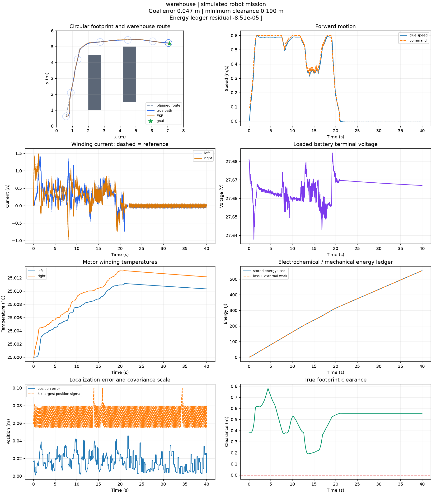

# Robot Drive to Autonomy

[](https://github.com/VictorOdoyo/robot-drive-to-autonomy/actions/workflows/ci.yml)

An electrical-engineering robotics laboratory that follows energy and signals
from a battery and motor windings through wheel traction, state estimation,
path planning and autonomous warehouse navigation.

The flagship experiment uses a coupled 18-state physical plant. Motor current
creates wheel torque; tire slip creates chassis force; drive power changes
battery voltage and SOC. Navigation runs through simulated sensors and an EKF,
rather than commanding ideal robot motion.



## Run it

Python 3.11 or newer; CPU only. No ROS, simulator server or hardware required.

```sh
uv sync --locked --extra dev
uv run robotlab list
uv run robotlab run --case warehouse --output outputs/warehouse
uv run robotlab batch --output outputs/catalog
uv run python examples/build_gallery.py
```

With pip: `python -m pip install -e ".[dev]"`, then use `robotlab` directly.
Open `outputs/warehouse/index.html` for the report. Each report includes
SI telemetry CSV, scientific plots, metrics, provenance, file hashes and a
pickle-free replay archive.

```sh
uv run robotlab replay outputs/warehouse/mission.npz --output outputs/replayed
uv run robotlab verify outputs/replayed
uv run robotlab run --config examples/custom_case.json --output outputs/custom
uv run python examples/control_analysis.py
```

## What is implemented

| Layer | Capabilities |
|---|---|
| Electrical drive | PM DC winding/rotor dynamics, four-quadrant averaged bridge, back EMF, copper temperature dependence, nested PI, anti-windup and electrical speed fallback |
| Power and mechanics | Thevenin battery, SOC, thermal states, bus sag, rotor-reflected inertia, slip-limited tires, grade load and an audited energy ledger |
| Estimation | Encoder rollover/quantization, noisy biased gyro, delayed packets, four-state pose/bias EKF, innovation gates and covariance diagnostics |
| Autonomy | Occupancy grids, footprint inflation, clearance-weighted A-star, exact visibility checks, pure pursuit, stopping constraints and fault supervision |
| Research tools | Known-landmark updates, delayed-fix replay, RTS smoothing, ICP, lidar mapping, DWA, heading/time lattices, coverage, multi-stop/energy routing and coupled LQR |

The mission pipeline uses the components described in
[architecture and navigation](docs/navigation.md). Additional algorithms are
separate study APIs; the project does not imply that every algorithm runs
inside the default mission.

## Experiments and measured evidence

The catalog has 11 reproducible scenarios: warehouse, commissioning, grade
load, traction loss, gyro bias, encoder outage, position outage, emergency
stop, hot windings, sensor latency and low charge.

The published warehouse run reaches its goal with approximately **0.19 m
minimum footprint clearance**, **0.047 m final position error**, and
**0.019 m position-estimation RMSE**. The emergency-stop experiment correctly
remains stopped before the goal. See the [measured results](docs/gallery/results.md)
and [experiment guide](docs/experiments.md) for configurations and interpretation.


## Engineering documentation

- [Physical equations and state vector](docs/physics.md)
- [Motor control and encoder-fault fallback](docs/control.md)
- [Estimation, uncertainty and sensor assumptions](docs/estimation.md)
- [Mapping, planning and navigation](docs/navigation.md)
- [Fault behavior and recovery](docs/faults.md)
- [Reproduction, archives and provenance](docs/reproducibility.md)
- [API study examples](docs/api.md)
- [Primary references](docs/references.md)

## Validation and scope

```sh
uv run ruff check src tests examples
uv run ruff format --check src tests examples
uv run python -m pytest -q
uv build
```

CI checks Linux and Windows on Python 3.11 and 3.13, plus code quality and an
installed-wheel smoke test outside the checkout. Tests cover conservation,
analytical transients, Jacobians, covariance structure, numerical refinement,
sampled stability and complete nominal/fault missions.

This is a simulation research project. The main plant is planar, uses averaged
PM DC motors and longitudinal tire slip, and navigates a known static map with
simulated absolute position fixes. It has no hardware validation, switching
inverter model, ROS drivers or full SLAM pipeline. Physical modeling limits and
the boundaries of supervisory stopping are documented alongside the equations.

MIT licensed. See [contributing guidance](CONTRIBUTING.md).
