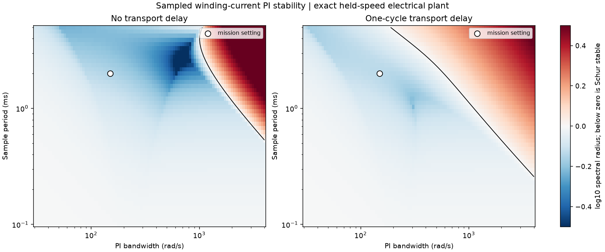
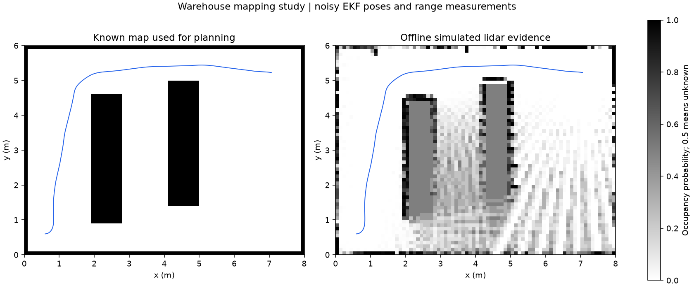

# Experiment guide

The [results table](gallery/results.md) and [machine-readable evidence](gallery/experiments.json)
contain generated measurements, configurations and source identifiers.
Default random seed is 42. Warehouse geometry is 8 m by 6 m; the smaller
commissioning room is 3 m by 3 m.

| Experiment | Change from commissioning | Interpretation |
|---|---|---|
| warehouse | Two shelves, longer route, 40 s horizon | Known-map navigation through the full drive/estimation chain |
| commissioning | Straight route, seven seconds | Nominal electrical and motion reference |
| grade-load | 0.12 rad grade during 1-4 s | Positive external work and increased drive losses |
| traction-loss | Left friction coefficient 0.004 during 1-2.5 s | Measurable tire slip, asymmetric actuation and recovery |
| gyro-bias | Additional 0.15 rad/s during 1-3 s | Increased heading/position error with gated correction |
| encoder-outage | Missing packets during 1-2 s | Timeout stop, electrical speed fallback and resumed navigation |
| position-outage | Missing fixes during 1-4 s | Age-based localization pause and recovery |
| emergency-stop | Request active during 2-3 s | Latched stop; deliberately does not reach the goal |
| hot-windings | Initial winding temperature 98 degrees C | Current derating while the winding cools |
| sensor-latency | 50 ms encoder transport latency | Increased control effort with delayed wheel feedback |
| low-charge | Initial SOC 0.08 | Lower loaded voltage and greater SOC consumption |

The short nominal run has gentle current demand and very little temperature
rise. The hot-winding experiment starts hot; it does not claim the robot heats
to 98 degrees C in a few seconds. The battery model is an illustrative affine
OCV/Thevenin model, not a chemistry-specific calibrated cell.

The warehouse example reaches its goal around the middle of the horizon and
continues logging its stopped state. Auxiliary consumption continues after
arrival. Reported energy therefore covers the complete configured horizon.

## Separate engineering studies

The black contour marks spectral radius one for a sampled winding PI loop.
The delay comparison holds the physical motor and PI tuning rule fixed. It
shows a smaller stable region with one update of transport delay. The white
marker identifies the mission bandwidth/sample-period pair. This calculation
assumes held wheel speed and does not prove nonlinear mission stability.

Offline mapping casts noisy lidar beams from the true simulated trajectory
and inserts them using noisy EKF poses. Unknown cells remain at probability
0.5. Occluded shelf interiors and unobserved floor are expected. This mapping
study does not change the known map used during navigation.

The control study also solves a loaded operating point, linearizes the
six-state electrical/wheel/chassis dynamics and designs sampled LQR feedback.
Its nonlinear response includes a current governor. Full-state feedback in
this benchmark is an explicit research assumption.

## Regression criteria

The complete warehouse regression requires goal error below 0.15 m, true
footprint clearance above 0.12 m, position RMSE below 0.06 m, winding current
below 8.5 A and energy-ledger residual below 0.002 J. Separate tests check
that each stress experiment exposes the intended effect. These thresholds
are tests for the published simulated scenarios, not universal operating limits.
